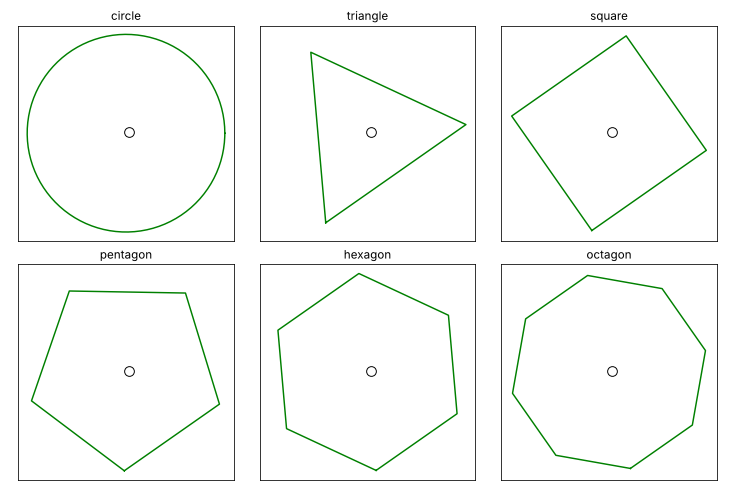

# BounceGame

A small hobby project. I'm interested in the trajectory of a ball bouncing
around inside a circle, and wanted to see if I could still implement the
high school maths behind it and visualise it with Python and Matplotlib.



## The maths

The ball is launched from a point $(x_0, y_0)$ with speed $v_0$ at an angle
$\theta$. Between bounces it follows one trajectory equation, projectile
motion under gravity, where $t$ is the time since the launch:

```math
x = x_0 + v_0 \cos\theta \, t, \qquad y = y_0 + v_0 \sin\theta \, t - \tfrac{1}{2} g t^2
```

When the ball hits a wall it bounces off by Newton's law of restitution. The
part of its velocity going into the wall is reversed and scaled by the
coefficient of restitution $e$. Friction with the wall scales the part along
the wall by $1 - \mu$. Together they give the new velocity:

```math
\mathbf{v}' = (1 - \mu)\,\mathbf{v} - (1 - \mu + e)\,(\mathbf{v} \cdot \hat{\mathbf{n}})\,\hat{\mathbf{n}}
```

Here $\hat{\mathbf{n}}$ is the unit vector pointing out of the wall, into the
board. With $e = 1$ and $\mu = 0$ it is a perfect mirror bounce,
$\mathbf{v}' = \mathbf{v} - 2(\mathbf{v} \cdot \hat{\mathbf{n}})\,\hat{\mathbf{n}}$.
The ball is then launched again from the bounce point, with $t$ back at 0,
speed $v_0 = |\mathbf{v}'|$ and angle $\theta = \arctan(v'_y / v'_x)$, taken
in the right quadrant.

The shape of the boundary only changes $\hat{\mathbf{n}}$. In a circle it
points from the ball towards the centre. In a polygon it is fixed for each
side. That is why every shape uses the same code.

Air drag is off by default. Setting $k > 0$ scales the speed by $(1 - k)$ per
unit of time, and the ball is then launched again every timestep with its
slower velocity.

## Install

You need Python 3.10 or newer.

```bash
git clone https://github.com/JiaWeiTeh/BounceGame.git
cd BounceGame
python -m venv .venv
source .venv/bin/activate        # Windows: .venv\Scripts\activate
pip install -r requirements.txt
```

No git? Click **Code → Download ZIP** on GitHub, unzip it, and run the last
three commands inside the folder. If `python` is not found, use `python3`.

## Run

```bash
python main.py
```

A window opens with the animation. Close it to stop.

To bounce the ball around a different shape:

```bash
python main.py --shape triangle
```

The shapes are `circle`, `triangle`, `square`, `pentagon`, `hexagon` and
`octagon`. Each run turns the shape to a random angle, so the ball does not
always land on a flat side at the bottom. The angle is printed, and `--tilt`
sets it in degrees. For example, `--tilt 0` puts a flat side at the bottom.

To see every shape side by side, as in the demo above:

```bash
python main.py --shape all
```

## Save a video

```bash
python main.py --save bounce.gif
python main.py --save bounce.mp4 --seconds 20
python main.py --save square.gif --shape square --tilt 45
```

GIF works out of the box. MP4 needs [ffmpeg](https://ffmpeg.org), for
example `brew install ffmpeg` or `conda install -c conda-forge ffmpeg`.
Clips last 12 seconds unless you pass `--seconds`. The demo above was
made with `python main.py --shape all --tilt 35 --save assets/bounce.gif`.

## Settings

Edit the values at the top of `main.py`. The main ones are:

| Name | Default | Meaning |
|---|---|---|
| `shape` | `'circle'` | Shape of the boundary, or `'all'` for every shape side by side. Also set with `--shape` |
| `tilt` | `None` | Angle to turn the shape by, in degrees. `None` picks a random angle each run |
| `rad` | 340 | Radius of the circle, or distance from the centre to the corners of other shapes |
| `ball_rad` | 10 | Ball radius used for collisions |
| `ball_ms` | 10 | Drawn ball size, in points |
| `v0` | 10 | Launch speed |
| `theta` | 20° | Launch angle above horizontal |
| `g` | 0.3 | Gravitational acceleration |
| `e` | 0.9 | Coeff of restitution: share of speed into the wall kept per bounce (0–1) |
| `mu` | 0.05 | Friction: share of speed along the wall lost per bounce (0–1) |
| `k` | 0 | Air drag: share of speed lost per unit time in flight (0–1), off by default |
| `dt` | 0.6 | Timestep per frame |

Units are arbitrary: distances are plot coordinates and time is simulation
time.

## Files

- `main.py` holds the settings, draws the board and runs the animation.
- `physics.py` holds the functions for the trajectory, bounce and drag.
- `test_physics.py` and `test_main.py` hold the tests.
- `assets/bounce.gif` is the demo animation of all six shapes.

## Test

```bash
pip install -r requirements-dev.txt
pytest
```

## License

MIT. See [LICENSE](LICENSE).
